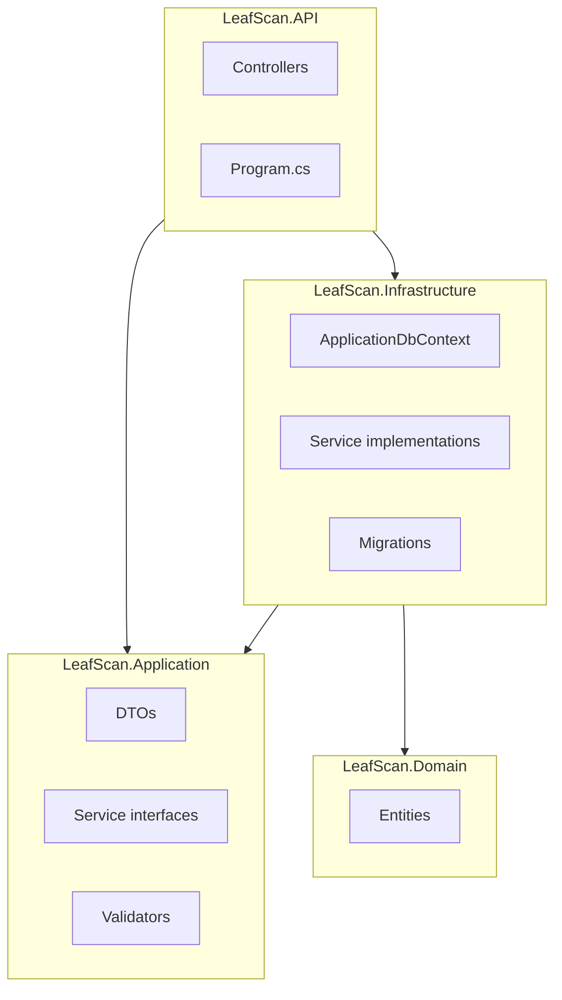
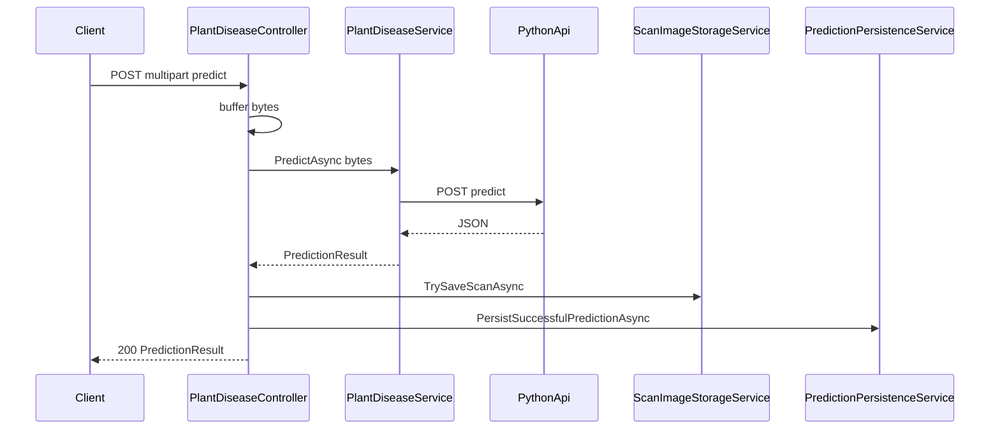

# LeafScan Backend — Architecture & Structure

This document describes the **folder layout**, **layering**, **workflows**, and **integration points** of the ASP.NET Core 8 REST API under `backend/`.

For setup, environment variables, and route-by-route API docs, see [README.md](README.md).

---

## Table of Contents

1. [Repository layout](#1-repository-layout)
2. [Architectural pattern](#2-architectural-pattern)
3. [LeafScan.API — host & HTTP](#3-leafscanapi--host--http)
4. [LeafScan.Domain — data model](#4-leafscandomain--data-model)
5. [LeafScan.Application — contracts](#5-leafscanapplication--contracts)
6. [LeafScan.Infrastructure — persistence & integrations](#6-leafscaninfrastructure--persistence--integrations)
7. [End-to-end workflows](#7-end-to-end-workflows)
8. [External systems](#8-external-systems)
9. [Tests & operations](#9-tests--operations)
10. [Navigation guide](#10-navigation-guide)

---

## 1. Repository layout

```
backend/
├── LeafScan.API/                 # ASP.NET Core 8 web host — HTTP entrypoints
├── LeafScan.Application/         # DTOs, service interfaces, FluentValidation validators
├── LeafScan.Domain/              # Entity models — no infra dependencies
├── LeafScan.Infrastructure/      # EF Core, SQL Server, service implementations, migrations, SQL scripts
├── LeafScan.Application.Tests/   # Unit tests (e.g. serialization / prediction DTOs)
├── README.md                     # Setup, auth, API reference
├── ARCHITECTURE.md               # This document
├── publish.ps1 | publish.sh | publish.bat   # Packaging for deployment
└── publish/                      # Build output after publish (not always in source control)
```

**Dependency rule:** API and Infrastructure reference Application; Infrastructure references Domain and Application; Domain has no project references to other layers.

**Runtime flow:** `HTTP → Controller → I*Service (Application) → Implementation (Infrastructure) → ApplicationDbContext / HttpClient`.

---

## 2. Architectural pattern

The solution uses a **layered (clean-ish) architecture**:

| Layer | Responsibility |
|-------|------------------|
| **Domain** | `User`, `Plant`, `PlantImage`, `Diagnosis`, crop tables, chat entities, etc. |
| **Application** | Request/response DTOs, `I*` service contracts, FluentValidation rules |
| **Infrastructure** | `ApplicationDbContext`, EF migrations, concrete services (auth, chat, ML proxy, admin stats, file storage), BCrypt/JWT |
| **API** | `Program.cs` (middleware, auth, CORS, JSON, DI), controllers, cookie helpers |

This keeps domain rules free of EF/HTTP details and localizes changes when swapping persistence or validators.

---

## 3. LeafScan.API — host & HTTP

### 3.1 `Program.cs`

- **Controllers** with **camelCase** JSON (`PropertyNamingPolicy = JsonNamingPolicy.CamelCase`).
- **Swagger** / **Swagger UI** in Development.
- **CORS** with `AllowCredentials`: origins include localhost, Capacitor/Android emulator patterns, `*.vercel.app`, and fixed production frontend URLs (see code for the exact list).
- **Authentication:** JWT Bearer. The handler reads the token from the `Authorization` header **or** the HttpOnly **`leafscan_access_token`** cookie (`JwtBearerEvents.OnMessageReceived`).
- **DI:** `AddInfrastructure(configuration)` registers DbContext and most services; `IPlantDiseaseService` is registered as a typed **HttpClient** with a **120 s** timeout (ML cold start).
- **FluentValidation** — validators discovered from the Application assembly.
- **Startup:** `Database.MigrateAsync()` runs in a scope at startup; failure is logged and the process exits (DB must be reachable).
- **Middleware order:** `UseCors` → `UseStaticFiles` (serves `wwwroot`, e.g. `/uploads/scans/...`) → `UseAuthentication` → `UseAuthorization` → `MapControllers`.
- **Root `GET /`** returns a small JSON index of notable routes.

### 3.2 Controllers (`LeafScan.API/Controllers/`)

| Controller | Purpose |
|------------|---------|
| `AuthController` | Register, login, logout, refresh, `me` — sets HttpOnly cookies |
| `UsersController` | Authenticated profile update (`PUT /api/users/me`) |
| `MessagesController` | User messages (CRM-style payloads) |
| `ChatController` | Chat / Kimi-backed flows |
| `CropServicesController` | Soil/climate/crop lists, recommendations, irrigation calculator (`lang`/`language`) |
| `PlantDiseaseController` | `POST /api/plant/predict` (multipart image → Python), warmup/health |
| `AdminController` | Admin-only: messages list/patch, `GET admin/stats`, `GET admin/diagnostics` |

### 3.3 Supporting API files

- `AuthCookie.cs` / refresh cookie helpers — paths, `SameSite`, `Secure`, lifetimes aligned with JWT and refresh TTLs.
- `Extensions/LanguageExtensions.cs` — language resolution for localized crop/chat responses.
- `appsettings.json`, `appsettings.Development.json`, `launchSettings.json`, `web.config`, `LeafScan.API.http`.

---

## 4. LeafScan.Domain — data model

POCO entities mapped by EF Core in `ApplicationDbContext`.

**Rough groupings:**

- **Identity / comms:** `User`, `Message`, `KimiChatMessage`
- **Plant-health core:** `Plant`, `PlantImage`, `Disease`, `Diagnosis`, `UserPlantImage`, `SoilData`
- **Chat / legacy ER pieces:** `AiChatbot`, `ChatSession`, `UserChat`, `Report`
- **Irrigation & recommendations:** `SoilType`, `Climate`, `Crop`, `CropSoilClimate`, `CropRequirement`, plus `SoilTypeTranslation`, `ClimateTranslation`, `CropTranslation`

Foreign keys and delete behaviors (`NoAction` vs `Cascade`) are configured in `OnModelCreating` to avoid cycles (e.g. `PlantImage` ↔ `User`).

---

## 5. LeafScan.Application — contracts

### 5.1 DTOs (`DTOs/`)

Examples: auth, messages, crop services, chat history, `PredictionResult` / plant disease, dashboard stats, admin operational diagnostics.

### 5.2 Service interfaces (`Services/`)

`IAuthService`, `IMessageService`, `IAdminService`, `IKimiChatService`, `ICropRecommendationService`, `IIrrigationCalculatorService`, `IPlantDiseaseService`, `IPredictionPersistenceService`, `IScanImageStorageService`.

### 5.3 Validators (`Validators/`)

FluentValidation for login, register, create message, update profile — invoked from controllers before calling services.

---

## 6. LeafScan.Infrastructure — persistence & integrations

### 6.1 Data

- `Data/ApplicationDbContext.cs` — `DbSet<>` declarations and fluent configuration.
- `Data/DesignTimeDbContextFactory.cs` — design-time factory for `dotnet ef` tools.

### 6.2 Migrations (`Migrations/`)

EF Core migration chain from initial identity/schema through ER tables, crop tables, translations, Kimi messages, refresh tokens, and operational seed migrations (system user/plants for scan persistence).

### 6.3 SQL scripts (`SqlScripts/`)

Operational / manual deployment scripts complementary to EF (schema notes, patches, supplemental seed data).

### 6.4 Services (`Services/`)

| Service | Role |
|---------|------|
| `AuthService` | Register/login/refresh/profile; BCrypt; refresh token persistence on `User` |
| `JwtService` | JWT creation and refresh token generation (singleton) |
| `MessageService` | Messages for users/admins |
| `AdminService` | Dashboard aggregates; operational diagnostics (counts + seed/migration hints) |
| `PlantDiseaseService` | Multipart forwarding to **`{PythonApi:BaseUrl}/predict`**; deserializes `PredictionResult`; handles cold-start behaviours |
| `PredictionPersistenceService` | After a successful prediction: persists `PlantImage` + `Diagnosis` (+ disease lookup/create); resolves plant via seeded system data |
| `ScanImageStorageService` | Saves scan bytes under `wwwroot/uploads/scans/{year}/`; returns `/uploads/...` URLs |
| `KimiChatService` | Moonshot API client (configured JSON conventions as implemented) |
| `CropRecommendationService` | Read models over soils/climates/crops |
| `IrrigationCalculatorService` | Read models using crop requirements |

### 6.5 Prediction helpers (`Prediction/`)

`PredictionSystemIds` — stable GUIDs/names used by EF seed and persistence for anonymous/system scan rows.

### 6.6 DI

`Extensions/ServiceCollectionExtensions.cs` — registers SQL Server `ApplicationDbContext` and scoped services (except `PlantDiseaseService` HttpClient registration, which is in `Program.cs` with timeout).

### 6.7 Project reference

Infrastructure targets `net8.0` and uses `FrameworkReference` to `Microsoft.AspNetCore.App` for `IWebHostEnvironment` (static file paths).

---

## 7. End-to-end workflows

### 7.1 Authentication

1. `POST /api/auth/login` or `register` validates input, verifies password (BCrypt), issues JWT + refresh token.
2. Response sets HttpOnly cookies (`leafscan_access_token`, path-scoped refresh cookie).
3. Subsequent requests send the access cookie; JWT middleware validates.
4. `POST /api/auth/refresh` rotates tokens when the access token expires.

### 7.2 Leaf scan (`POST /api/plant/predict`)

1. Controller buffers the upload **once**.
2. `IPlantDiseaseService` posts bytes to the Python service; returns `PredictionResult`.
3. Optional: `IScanImageStorageService` writes under `wwwroot` and returns a public-relative URL.
4. Optional: `IPredictionPersistenceService` inserts `PlantImage` + `Diagnosis` (and disease row as needed). Failures are **logged**; the HTTP response can still be **200** with the ML result.

### 7.3 Admin dashboard

- `GET /api/admin/stats` — aggregated counts and charts from SQL (requires **Admin** role).
- `GET /api/admin/diagnostics` — row counts, presence of seed user/plant, whether the seed migration id is in `__EFMigrationsHistory` (troubleshooting zero stats).

### 7.4 Crop advisory

`CropServicesController` delegates to recommendation/irrigation services; results can be localized using translation tables and request language parameters.

### 7.5 Chat

`ChatController` + `KimiChatService` — authenticated outbound calls to the configured LLM base URL and API key; messages may be stored per `KimiChatMessage` and related session models.

---

## 8. External systems

| System | Role | Configuration |
|--------|------|----------------|
| **SQL Server** | Primary database | `ConnectionStrings:DefaultConnection` |
| **JWT** | Access token signing | `Jwt:Issuer`, `Jwt:Audience`, `Jwt:Key` |
| **Python FastAPI** | Image classification | `PythonApi:BaseUrl` |
| **Moonshot Kimi** | LLM chat | `Kimi` section in configuration (see `appsettings` / host secrets) |

---

## 9. Tests & operations

- **LeafScan.Application.Tests** — unit-level tests on application concerns without full web host.
- **Publish scripts** (`publish.ps1`, `publish.sh`, `publish.bat`) — `dotnet publish` into `publish/`; PowerShell variant can overlay production connection string into published `appsettings.json` when `appsettings.Production.json` exists.

---

## 10. Navigation guide

| Task | Where to look |
|------|----------------|
| Add or change routes / auth | `LeafScan.API/Controllers/`, `Program.cs` |
| Change request/response shapes | `LeafScan.Application/DTOs/`, `Validators/` |
| Add or change tables | `LeafScan.Domain/Entities/`, new migration, `ApplicationDbContext` |
| Business logic & SQL | `LeafScan.Infrastructure/Services/` |
| Dashboard aggregations | `AdminService.cs` |
| ML proxy & persistence & disk | `PlantDiseaseController`, `PlantDiseaseService`, `PredictionPersistenceService`, `ScanImageStorageService` |
| EF migrations | `LeafScan.Infrastructure/Migrations/` |
| Manual SQL / DBA notes | `LeafScan.Infrastructure/SqlScripts/` |

---

## Diagrams

### Layer dependency (build-time)



### Predict path (runtime)



---

*Last updated to match the backend layout and behaviour of this repository; adjust this file when you add major features or new projects under `backend/`.*
